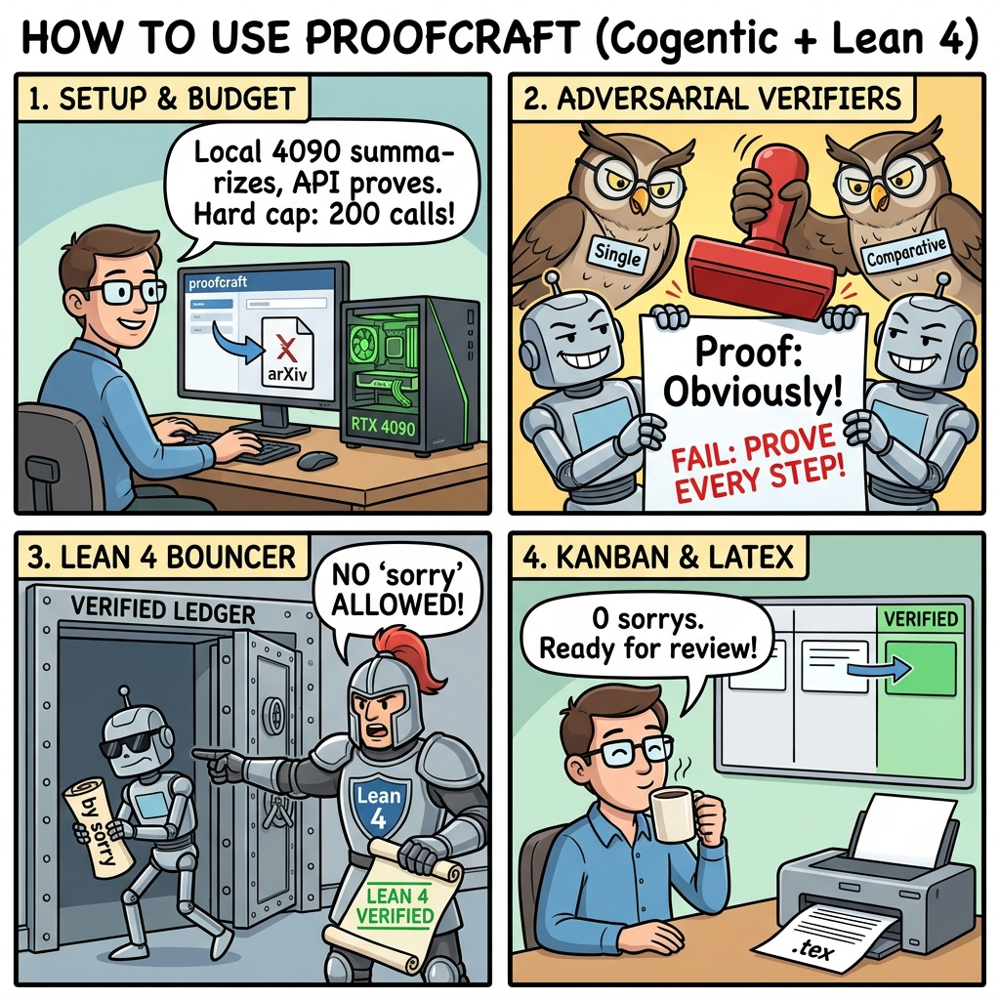

# proofcraft

**Cogentic-style multi-agent automated proof discovery studio with Lean 4 -- pure Rust (L1 core, L2 CLI + MCP, L3 egui).**

Inspired by [Cogentic: Multi-Agent Orchestration for Automated Proof Discovery](https://arxiv.org/abs/2609.40324) (arXiv:2609.40324v2), `proofcraft` brings the iterative prove-verify-ledger architecture to a local-first workstation (RTX 4090 / Ollama / LM Studio + optional frontier APIs + Lean 4 / Lake / Mathlib).



## Quick Start

**Fastest way:** just tell Claude / agy / Cursor:

> *"install proofcraft from gh sandraschi"*

Or from a terminal:

```powershell
# Launch desktop studio (builds incrementally and opens GUI)
.\start.bat

# Run checks, tests, or MCP stdio server
just ci
.\start.ps1 -Smoke
.\start.ps1 -Mcp
```

## Documentation Stack

| Guide | Covers |
|---|---|
| [Math, Cogentic & Calls](docs/MATH_AND_COGENTIC.md) | Required math levels, Cogentic paper (`arXiv:2609.40324`), what a "call" is (`3*N + 2`), and problem sources |
| [Lean 4 Core Guide](docs/LEAN4_GUIDE.md) | Automatic `lean` detection, `sorry`/`admit` guard, and runnable pure Lean 4 examples |
| [Lake & Mathlib Guide](docs/LAKE_AND_MATHLIB.md) | `lake` setup, `mathlib-lab` with `lake exe cache get`, `Lake Project Dir`, and Lake project export |
| [CLI, MCP & Launchers](docs/CLI_AND_MCP.md) | All CLI subcommands, 15 MCP `2026-07-28` tools, and `start.bat`/`start.ps1` |
| [HELP.md](HELP.md) | Quick in-repo reference mirroring the 7-tab in-app Help Center |

## Architecture

- **`crates/proofcraft-core` (L1):** SQLite Record & Verified Ledger, independent Summarizer briefings, Prover + Two-Tier Adversarial Verifier loop, Isolated Lemma Auditor, non-mathematical Process Advisor, live LLM discovery, online importer + curated packs, hard call/round/USD budget caps, and Lean 4 / Lake verification.
- **`crates/proofcraft-mcp` (L2):** `clap` CLI and pure-Rust MCP `2026-07-28` stdio server (`proofcraft-mcp mcp`, 15 tools + `skill://proofcraft/SKILL.md`).
- **`crates/proofcraft-app` (L3):** Native `eframe`/`egui 0.37` desktop studio with Kanban board, animated 8-stage Cogentic + Lean 4 loop visualizer, round telemetry chart, 3 high-contrast skins (Obsidian Dark, Crisp Light, Ivory Proof), Copilot dock, 7-tab Help Center, and full-window Settings (`Ctrl+,`).

## Feature Matrix

| Feature | Status | Notes |
|---|---|---|
| Kanban Pipeline Board + `PAPER DEMO` vs `LOCAL` badges | `Implemented` | Queued, In Progress, Verified, Budget Cap |
| Animated 8-Stage Cogentic + Lean 4 Loop & Telemetry Chart | `Implemented` | Live pulse during rounds + Play/Pause replay |
| Two-Tier Adversarial Verification + Isolated Lemma Auditor | `Implemented` | Individual + Comparative verifiers + Dead Ends |
| Lean 4 Formal Verification (`lean --stdin` + `sorry` guard) | `Implemented` | Rejects `sorry`/`admit`; one-click & auto-formalize |
| Lake / Mathlib Workspace Support & Lake Project Export | `Implemented` | `lake env lean --stdin` + `lakefile.toml` export |
| Online Problem Importer (`arXiv`, `erdosproblems.com`, `.lean`) & Packs | `Implemented` | Warmup, Erdos, and Cogentic packs |
| Live LLM Discovery & Hybrid Role Routing (Ollama/LM Studio/APIs) | `Implemented` | Excludes embed-only models; masked key status |
| Pure-Rust CLI & MCP Stdio (`2026-07-28`, 15 tools) | `Implemented` | `proofcraft-mcp mcp` + `skill://` resource |
| Native `egui` Studio (3 skins, Copilot, 7-Tab Help, Settings, `.tex`/`.md`) | `Implemented` | `--smoke-test` + headless `egui` frame tests |

## License

Dual-licensed under `MIT OR Apache-2.0`.
